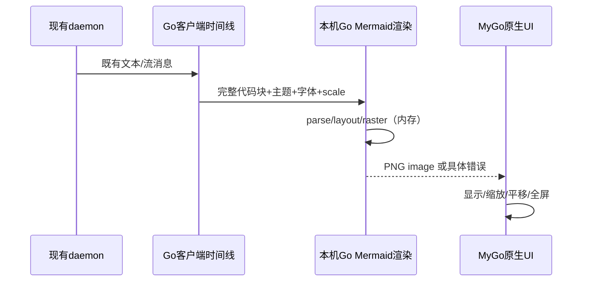

# Go 原生客户端执行契约（advisor 复审附件）

## 禁止的范围扩张

不存在新增的探针守护进程、systemd服务、daemon子进程、TTY监控或新RPC协议。临时probe仅是本机实验程序，不能引入产品。Go应用直接连接现有daemon `/ws`；终端通过现有订阅及二进制opcodes Output=1/Input=2/Resize=3/Snapshot=4/Restore=5和slot路由，格式见 packages/protocol/src/binary-frames/terminal.ts。PTY仍在现有daemon terminal worker，客户端永不启动PTY或管理daemon。

## 第一波工作包/API契约（设计，不是已实现代码）

Go模块 `packages/native-desktop`；仅在advisor同意后创建。公开接口先留在模块internal，不发布独立SDK。`Client` 方法规划：`Connect(ctx, Target) error`、`Close() error`、`Call(ctx, requestType string, payload json.RawMessage) (json.RawMessage,error)`、`Observe(ctx, Observation) (Subscription,error)`；`Subscription` 提供按序更新与 `Close`；连接事件报告connecting/online/disconnected及epoch。业务界面不得拼接requestId或自动重试mutation。client.Call只接受现有wire request type，按现有requestId关联响应；超时/断线后返回明确错误，已发送未确认结果标unknown。Close取消等待者和订阅并释放底层连接；重连由session单一owner驱动，owner恢复表面需求后重新对账。

首个可运行纵切片只使用当前协议实际方法：握手/status.server_info、工作区/agent目录查询、观察一个agent时间线和读取历史、发送prompt和权限决定；具体wire tag以messages.ts为准，不发明SessionStartRequest。先实现只读连接纵切片，再接已有写请求，用户操作前明确展示目标host。终端在第二波实现attach/input/resize/snapshot，不能与普通消息接口共用不受限事件队列。Call是内部协议层，不替代最终业务方法/校验。

调用生命周期：Connect -> 协商server_info -> 查询已有agent -> Observe其timeline -> fetch权威历史 -> 用户提交现有prompt请求 -> 按seq应用输出 -> Subscription.Close -> Client.Close。创建agent使用现有create请求，不能把业务agent与WebSocket session混称。终端的创建/attach是另一套现有RPC，slot由daemon分配；用户按键编码为Input(slot,bytes)，daemon回Output(slot,bytes)，resize按现有intent处理，重连时重新attach并应用快照后接增量。释放一个视图只撤销其需求，不停止daemon或删除远程terminal。

## Mermaid 渲染契约

全部在客户端；daemon只传现有timeline文本，不解析、不拦截、不渲染。markdown renderer识别已闭合mermaid fence，调用本机Go解析/布局/PNG rasterizer，在有界后台任务队列执行。source+theme+font+scale作为内存缓存键，页面释放减引用，按字节上限LRU淘汰；无需共享文件、daemon附件上传或远端渲染。结果PNG解码成原生ui.Image；缩放触发适当分辨率重绘，pan/fullscreen由原生容器实现。渲染过程中保留上一成功结果和loading，首次无结果时预留容器；语法错误显示错误说明与可复制源码和重试，错误不算有效语法的功能替代。合法但候选不支持的语法是待修功能，禁止以源码fallback作为通过。

中文实测失败（默认Go字体缺字），没有fallback通过；需为raster包提供CJK字体/fallback、字体度量与布局一致性，必要时维护小型上游补丁。图表语法支持需以现有Mermaid.js版本及实际renderer选项建立代表fixture并扩充；单图通过不代表全量。候选可行但未经完整验证；此包在完成全部语法/字体验收前不得标记完成。

## 执行波次和完成门槛

A：独立Go既有协议/client：文本RPC关联+现有二进制编解码+断线/unknown语义，真实临时daemon smoke；不改wire/server。
B：独立Mermaid适配：候选库CJK和图表支持实验、小型可运行MyGo展示；不改timeline数据模型。若候选不行继续补实现，不减少范围。
A完成后C：原生主机/工作区/会话纵切片，依赖A的Client内部接口。终端真实daemon、语音延期、插件延期均不能被误写成已通过。

A与B可以并行，C有真实依赖后再派发。集成owner为主代理；子代理不运行仓库全套测试，不改共享协议；集成后一次运行相关Go检查和仓库必要typecheck/lint。macOS/Windows真实验收、所有Mermaid有效语法和中文是对应完成/发布条件，而非先实现全部再允许A开工的循环条件。全产品最终仍覆盖除用户明确延期项和daemon管理外所有Electron能力；前三包不是缩减后的最终交付。
